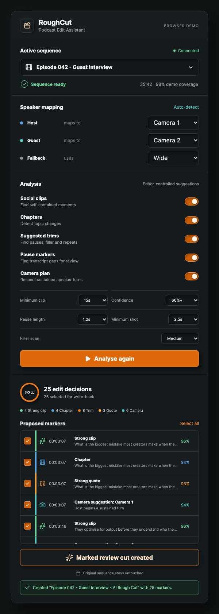
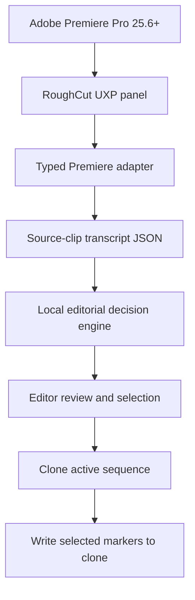

# RoughCut

RoughCut is a transcript-aware podcast editing assistant for Adobe Premiere Pro. It reads transcripts already attached to source clips, turns them into reviewable edit decisions, and creates a marked review sequence without changing the original timeline.



## Why RoughCut

Professional podcast editors usually do not need another automatic editor that hides its decisions. They need a faster first pass that remains understandable and editable.

RoughCut keeps the editor in control:

- Every suggestion is visible before it is written to Premiere.
- Individual markers can be selected or rejected.
- The original sequence is never modified.
- Premiere's existing transcripts are reused instead of running transcription twice.
- The Premiere host never silently substitutes mock analysis data.

## Current Features

- Active project and sequence detection through Premiere UXP.
- Source-clip transcript discovery and JSON export.
- Transcript timing normalized to sequence time.
- Social clip and strong quote suggestions.
- Chapter suggestions.
- Configurable filler-word review.
- Transcript-gap and pause detection.
- Adjacent trim-region merging.
- Speaker-to-camera mapping.
- Minimum-shot camera planning.
- Short-interjection suppression.
- Wide-shot suggestions for overlapping speakers.
- Confidence filtering and per-marker selection.
- Undoable sequence clone, rename, and marker transactions.
- Responsive, accessible neumorphic interface with no purple palette.

## Important Boundary

RoughCut currently creates a **marked review sequence**, not a finished automatic edit.

Camera decisions, filler regions, pauses, chapters, and selects are written as review markers on a cloned sequence. Native multicam angle switching and destructive ripple deletion are deliberately excluded until they can be implemented through a reliable, supported Premiere UXP timeline API.

Remote AI analysis is also not connected yet. The current editorial engine is deterministic and runs locally without credentials.

## Architecture



The browser development path uses `MockPremiereAdapter`. The Premiere build uses the real `premierepro` module through the same typed interface.

## Requirements

- Adobe Premiere Pro 25.6 or newer.
- Adobe UXP Developer Tool 2.2 or newer.
- Node.js 20 or newer for local development.
- A Premiere project containing an active sequence with transcribed source clips.

## Install for Development

```bash
git clone https://github.com/jimbrouw/banans.git
cd banans
npm install
npm run build:uxp
```

The loadable plugin is generated in `plugin-dist/`.

1. Enable **Developer Mode** in Premiere under **Settings > Plugins**.
2. Restart Premiere.
3. Open Adobe UXP Developer Tools.
4. Choose **Add Plugin** and select `plugin-dist/manifest.json`.
5. Click **Load & Watch**.
6. Open **Window > UXP Plugins > RoughCut** in Premiere.

## Test the Workflow

1. Open a sequence containing transcribed source clips.
2. Open RoughCut.
3. Map speakers to cameras.
4. Configure clip length, confidence, pause, shot, and filler settings.
5. Click **Analyse transcript**.
6. Review and select the proposed markers.
7. Click **Create Marked Review Cut**.
8. Confirm Premiere opens `<original sequence> - AI Rough Cut`.
9. Confirm the original sequence has no new markers or edits.

If RoughCut reports that it cannot find a transcript, transcribe the relevant source clips through Premiere's Text panel. Sequence-only transcript data that is not attached to source clip project items cannot currently be exported through `Transcript.exportToJSON`.

## Browser Demo

```bash
npm run dev
```

Open the local Vite URL, click **Analyse transcript**, review the seeded decisions, and create the mock review cut.

## Quality Checks

```bash
npm test
npm run lint
npm run build:uxp
```

Current automated coverage includes transcript normalization, timeline offsets, filler and pause decisions, trim merging, short-interjection handling, overlap-to-wide camera planning, and UXP bundle validation.

## Project Structure

```text
src/
  App.tsx                  Plugin workflow and state
  analyse.ts              Editorial decision engine
  premiereAdapter.ts      Real Premiere UXP integration
  mockPremiere.ts         Browser development adapter
  hostRuntime.ts          UXP runtime and panel registration
  types.ts                Shared contracts
public/manifest.json      Premiere UXP manifest
scripts/                  UXP build finalization
design/                   Accepted interface concept
MERGE_REVIEW.md           Legacy plugin comparison and merge record
```

## Packaging

For development, load `plugin-dist/manifest.json` directly. For a distributable `.ccx`, use **Package** in Adobe UXP Developer Tools.

The manifest currently uses a development plugin ID. Replace it with an ID from Adobe Developer Distribution before Marketplace submission.

## Roadmap

1. Validate the plugin against several real multicam podcast projects.
2. Add structured model analysis behind an explicit provider boundary.
3. Add optional local audio-energy analysis for overlaps and silence.
4. Build a supported flattened rough-cut workflow.
5. Add social cutdown and chapter export workflows.

## Design

The interface uses selective neumorphism: tactile depth is reserved for controls, while content regions remain flat and readable. The palette uses graphite surfaces, amber actions, cyan information, and mint success states.

The accepted concept is stored at [`design/roughcut-neumorphic-concept.png`](design/roughcut-neumorphic-concept.png).

## Status

RoughCut is an active technical preview. Use duplicate media and test projects until the Premiere workflow has been validated across more real-world project structures.
